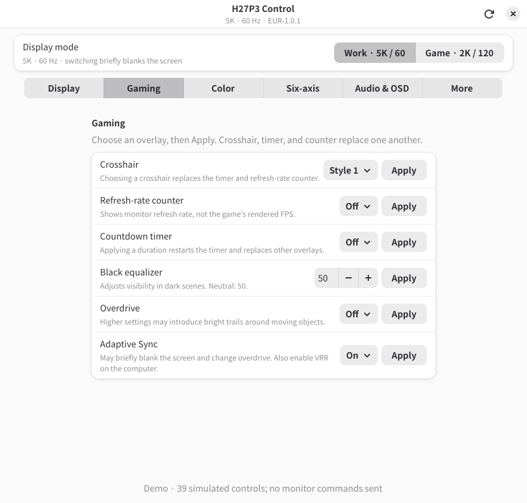
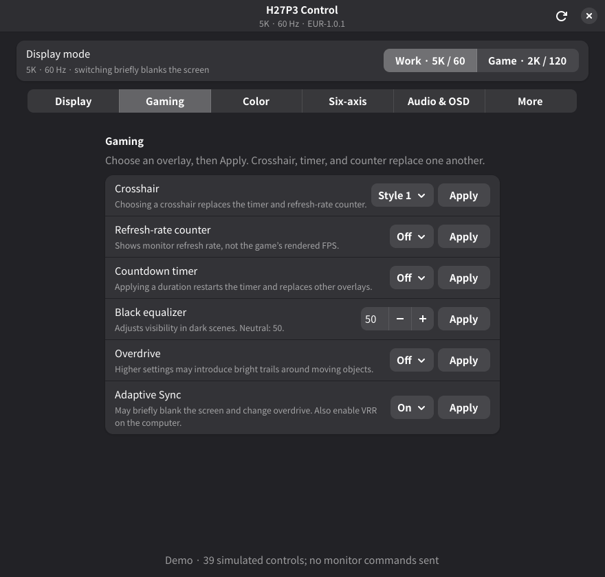

# H27P3 Control

A Linux desktop app for the **KTC H27P3**: switch between 5K/60 Hz work mode and
1440p/120 Hz gaming mode, select a crosshair, and adjust 39 monitor settings.
The native Rust/GTK4/libadwaita interface follows the desktop light/dark preference
and reloads user GTK stylesheets when their colors change, including Noctalia CSS.

**Supported firmware: `EUR-1.0.1`, build `KSDA25040451`.** This is an independent,
experimental project tested on one monitor over DisplayPort. The backend rejects
other firmware builds. Communication uses DDC/CI over the display connection;
an additional USB cable is not required.

| Light | Dark |
| --- | --- |
|  |  |

Screenshots use demo data.

## Build and run

With Nix and flakes enabled:

```sh
nix build
./result/bin/h27p3-control
```

Or use the legacy Nix commands; both use the revision pinned in `flake.lock`:

```sh
nix-build
./result/bin/h27p3-control
```

To try the interface without a monitor:

```sh
./result/bin/h27p3-control --demo
```

The package includes the Python backend, ddcutil, GTK schemas, and a desktop
launcher. To keep it installed in your user profile:

```sh
nix profile install .
```

The build uses Nix-provided tools and libraries. There are no Cargo registry or
Python package dependencies. Nix may download its pinned packages; Cargo builds
with the network disabled by `--frozen`. The package is tested on x86_64 Linux;
the flake also provides an aarch64 Linux output, which has not been hardware-tested.

## Monitor access

Enable DDC/CI in the monitor's OSD. The app needs access to the relevant
`/dev/i2c-*` device, with the same permissions required by `ddcutil detect`.
It does not elevate privileges. For NixOS, enable I2C access and add your user
to its group in your system configuration:

```nix
hardware.i2c.enable = true;
users.users.YOUR_USERNAME.extraGroups = [ "i2c" ];
```

Apply the configuration and log in again for a new group membership to take
effect. Check detection inside `nix-shell` with `ddcutil detect`. Automatic
discovery requires exactly one H27P3. If reads fail, wake the display, close
other monitor-control tools, and press **Refresh**. Docks and adapters may
affect DDC access; only a direct DisplayPort connection has been tested.

## Controls

Choose a value and press **Apply**. **Refresh** reads changes made through the
monitor's physical menu. Requests run in a worker so the interface remains
responsive; overlapping requests are rejected.

| Page | Controls |
| --- | --- |
| Display mode | Work: 5120×2880 at 60 Hz; game: 2560×1440 at 120 Hz |
| Display | Brightness, contrast, sharpness, dynamic contrast, HDR auto/off, aspect ratio |
| Gaming | Six crosshair styles, refresh-rate counter, countdown timer, black equalizer, overdrive, Adaptive Sync |
| Color | Color space, gamma, temperature, RGB gain, low blue light |
| Six-axis | Hue and saturation for red, green, blue, cyan, magenta, yellow |
| Audio & OSD | Headphone volume, mute, menu position, timeout, transparency, color, power indicator |

The hardware mode switch writes two stored preferences and restarts the monitor.
Expect about five seconds of blackout; discovery and verification take longer.
The desktop must select a suitable resolution after the display reconnects.
The app does not edit compositor configuration. Selecting the already active
hardware mode leaves its stored preferences unchanged.

Crosshair, timer, and refresh-rate counter share one overlay. Selecting one
clears the other two selections. The counter reports the monitor's refresh
rate, not a game's rendered FPS.

Select **Native** color space before adjusting color channels, and **User**
temperature before editing RGB gain. Dynamic contrast must be off to adjust
brightness. Black equalizer uses steps of 5; low blue light uses steps of 25.
Adaptive Sync may blank the display briefly and change overdrive; the computer
must also enable VRR. Hue/saturation changes can affect stored picture profiles.

Night Vision/Eagle Eye commands remain unidentified. Crosshair color/position
queries are unsupported on the tested firmware. Input selection, USB settings,
OSD language, and picture presets are not exposed. The **More** page explains
these limits. Firmware flashing, factory reset, and arbitrary command entry
are outside this application's scope.

## Evidence and limits

All 39 controls were read successfully on the tested monitor. Both directions
of the hardware mode switch were verified through EDID, active display timing,
and a comparison of the stored settings. Crosshair values 0–6, counter on/off,
timer on/off, black equalizer, brightness, overdrive, menu transparency, and
menu color passed write/readback tests. A representative round trip restored
all 39 reported values to their baseline.

Readback confirms retained settings; it does not independently confirm each
visible effect. Physical overlay appearance and the remaining controls' full
ranges have not all been tested. The mappings combine static analysis of the
official Windows app and a downloadable firmware image with live measurements.
That image differs from the tested EU build and was never flashed. See
[protocol and research notes](docs/protocol.md) for the codes, command sequence,
source fingerprints, and known ambiguities. No vendor executable was run.

The backend checks EDID, firmware/build, checksums, ranges, and setting
dependencies. Mode switching includes readback and limited rollback before
restart. Failures are reported; press **Refresh** to read the actual state.
Audit captures are written with private file permissions under
`${XDG_STATE_HOME:-~/.local/state}/h27p3/`. They contain device information and
settings, and are not firmware backups.

## Development

```sh
nix-shell --run './scripts/check'
nix flake check
```

The checks run Rust parser tests and Python tests for protocol validation,
setting dependencies, and mode-switch failure handling. They never open an
I2C device. Building the Nix package runs the unit tests too. For an additional
GUI test, run this in a graphical session:

```sh
./result/bin/h27p3-control --smoke-test
```

Demo and smoke-test modes never access a monitor. To capture only the app's
widget tree using stock libadwaita colors:

```sh
XDG_CONFIG_HOME="$(mktemp -d)" ./result/bin/h27p3-control \
  --screenshot /tmp/h27p3.png --preview-page Gaming --preview-dark
```

`--preview-light` and `--preview-dark` imply demo mode. Normal launches always
follow the system preference and live user CSS.

`src/` contains the UI and a small GTK/libadwaita C ABI binding module.
`backend/control.py` owns the feature catalog and GUI protocol;
`backend/h27p3-mode.py` implements the guarded hardware-mode switch. The backend
uses only Python's standard library, with ddcutil for bus discovery. Development
overrides `H27P3_BACKEND` and `H27P3_PYTHON` select the backend and interpreter;
the Nix wrapper supplies their installed paths.

When extending support, document the model, exact firmware/build, source of the
mapping, and what was actually verified. Add failure-path tests before enabling
new writes. Keep vendor binaries and raw hardware captures out of the repository.

## License

[MIT](LICENSE). KTC's proprietary applications and firmware are not distributed
or licensed by this project.
